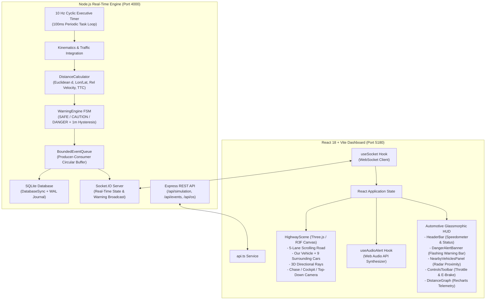

# SMARTDRIVE 3D — Real-Time Vehicle Distance Monitoring & Collision Warning System

> **Academic Operating Systems & ADAS 3D Simulation Project**  
> Full-Stack TypeScript | Node.js Engine | Three.js & React Three Fiber | Socket.IO | SQLite WAL Persistence

---

## 🚀 Overview

**SMARTDRIVE 3D** is an interactive, full-stack Advanced Driver Assistance System (ADAS) and real-time Operating Systems simulation. It simulates a reference host vehicle ("Our Vehicle") driving on a multi-lane highway surrounded by 9 autonomous vehicles.

The system features an **authoritative backend calculation engine** running on a deterministic **10 Hz periodic cyclic timer loop** that computes exact Euclidean distances, longitudinal/lateral separations, relative velocities, and Time-to-Collision (TTC) metrics. State changes transition deterministically through **SAFE**, **CAUTION**, and **DANGER** states with deadband hysteresis, triggering Web Audio warning sirens, dynamic 3D directional detection rays, and persistent SQLite audit logging.

---

## 🎯 Key Project Highlights

1. **Authoritative Backend Calculation Engine**:
   - Computes true Euclidean geometry $d = \sqrt{(x_2 - x_1)^2 + (y_2 - y_1)^2}$ and relative velocity in the Node.js backend.
   - The frontend never invents or overrides distance values.
2. **Interactive 3D Driving Environment (Three.js / React Three Fiber)**:
   - 5-lane highway with infinite scrolling asphalt markings tied directly to vehicle velocity.
   - Smooth 3-camera system: **Chase Perspective**, **Driver Cockpit**, and **Bird's Eye Top-Down**.
   - Procedural 3D vehicles (sedans, SUVs, trucks, sports cars) with working wheels, headlights, brake LEDs, and road drop shadows.
   - 3D directional detection rays and floating metric distance badges with target crosshairs.
3. **Rigorous Operating Systems Academic Architecture**:
   - Implements 7 core OS primitives: Periodic Cyclic Task Scheduling, Producer-Consumer Bounded Circular Queue, Hysteresis FSM, Atomic State Transitions, IPC via WebSockets, Persistent Storage Subsystems with WAL, and POSIX Signal Trapping (`SIGINT`/`SIGTERM`).
4. **Zero External Asset Vulnerabilities**:
   - All 3D vehicles are procedural geometries; all caution/danger warning chimes and sirens are synthesized dynamically in real time via the browser's native **Web Audio API** (`AudioContext` oscillators). Zero CDN, 404, or audio loading failures.

---

## 🏛️ System Architecture



---

## 📐 Mathematical Formulation

### 1. Authoritative Euclidean Distance
For "Our Vehicle" at coordinate $(x_1, y_1)$ and target vehicle at $(x_2, y_2)$:

$$d = \sqrt{(x_2 - x_1)^2 + (y_2 - y_1)^2}$$

*Note: In the simulation coordinate space, longitudinal travel is along the $y$-axis, lateral position across lanes is along the $x$-axis.*

### 2. Longitudinal & Lateral Separation
- **Longitudinal Distance ($\Delta y$)**: $\Delta y = y_2 - y_1$  
  - $\Delta y > 0 \implies$ Vehicle is ahead (Front).
  - $\Delta y < 0 \implies$ Vehicle is behind (Rear).
- **Lateral Distance ($\Delta x$)**: $\Delta x = x_2 - x_1$  
  - $\Delta x < 0 \implies$ Vehicle is to the Left.
  - $\Delta x > 0 \implies$ Vehicle is to the Right.

### 3. Relative Closing Velocity
$$\Delta v_{\text{rel}} = v_{\text{target}} - v_{\text{our}}$$

- For vehicles ahead ($\Delta y > 0$): closing speed is $v_{\text{closing}} = v_{\text{our}} - v_{\text{target}} = -\Delta v_{\text{rel}}$.
- For vehicles behind ($\Delta y < 0$): closing speed is $v_{\text{closing}} = v_{\text{target}} - v_{\text{our}} = \Delta v_{\text{rel}}$.

### 4. Time-to-Collision (TTC)
For vehicles with positive closing speed ($v_{\text{closing}} > 0$):

$$\text{TTC} = \frac{|\Delta y|}{v_{\text{closing}}}$$

*Edge Case Handling*: If closing speed is $\le 0$ (the distance between vehicles is opening or stable), TTC is mathematically non-existent ($+\infty$). The engine safely returns `null` and suppresses false collision alarms.

---

## 💻 Operating Systems Concepts Implementation

| # | OS Concept | Implementation in SMARTDRIVE 3D |
|---|------------|---------------------------------|
| **1** | **Periodic Real-Time Task Scheduling** | The backend simulation uses a deterministic 10 Hz (100ms) cyclic tick scheduler. Each tick executes a structured 3-phase pipeline: Kinematics Integration $\to$ Distance Geometry $\to$ State Machine Evaluation. |
| **2** | **Producer-Consumer Pattern & Bounded Buffers** | Implemented via `BoundedEventQueue.ts`. The simulation produces warning events that are consumed by the SQLite persistence worker and WebSocket dispatcher. A fixed capacity (100 events) with high-watermark telemetry prevents unbounded memory growth. |
| **3** | **State Machine with Hysteresis & Deadband** | Prevents high-frequency warning oscillation (chatter/thrashing) when a vehicle hovers near the 15m or 30m boundary. A 1.0m deadband ensures transitions from DANGER to CAUTION require exceeding 16.0m. Consecutive duplicate events are suppressed. |
| **4** | **Critical Sections & Atomic State Updates** | Simulation state updates occur synchronously in an atomic evaluation tick before client read requests or WebSocket diff calculations are processed, preventing race conditions. |
| **5** | **Inter-Process & Network Communication (IPC)** | Employs persistent, full-duplex WebSockets (Socket.IO) for telemetry streaming and discrete priority warning broadcasts, combined with RESTful HTTP endpoints for lifecycle management. |
| **6** | **Persistent Storage & Write Buffering** | Warning events are persisted to SQLite using Node.js 24's native `node:sqlite` `DatabaseSync` engine with Write-Ahead Logging (WAL) for crash resilience, backed by an in-memory ring buffer fallback. |
| **7** | **Graceful Shutdown & Signal Trapping** | Registers POSIX signal handlers (`SIGINT`, `SIGTERM`) to flush bounded event queues, terminate active WebSocket sessions, stop cyclic intervals, and safely close the SQLite database connection before exiting. |

---

## 🎓 Five-Minute Faculty Demonstration Script

This script is curated for student presentations and faculty viva examinations. It guides you step-by-step through a 5-minute interactive demonstration:

### **Minute 1: Introduction & Architecture Overview**
- **Action**: Launch the application via `run_smartdrive.bat` or `run_smartdrive_3d.bat`.
- **Explain to Faculty**:
  - *"Respected professors, SMARTDRIVE 3D is a full-stack real-time Operating Systems simulation of an Advanced Driver Assistance System (ADAS)."*
  - *"The architecture decouples an authoritative Node.js backend calculation engine from a Three.js / React Three Fiber 3D client over full-duplex WebSockets."*
  - Point to the **Header Bar**: Show the 90 km/h speedometer ($25\text{ m/s}$), WebSocket latency ($<15\text{ ms}$), and the `SIMULATED DATA` disclaimer badge.

### **Minute 2: 3D Visualization & Multi-Perspective Cameras**
- **Action**: Press keys `1`, `2`, and `3` (or click Chase / Cockpit / Top-Down buttons in the top right).
- **Explain to Faculty**:
  - Point out key `1`: **Chase Perspective** tracking behind our vehicle. Point out the animated asphalt dashed lines that speed up or slow down with our throttle.
  - Point out key `2`: **Driver Cockpit Camera** showing the forward road view directly from the driver's perspective.
  - Point out key `3`: **Top-Down Bird's Eye View** showing all 5 highway lanes and lateral/longitudinal vehicle buffers.
  - Point to the floating 3D billboard callouts: *"Each badge shows the vehicle's quadrant, true Euclidean distance, and relative closing velocity."*

### **Minute 3: Collision Warning Scenarios & Emergency Braking**
- **Action**: Click the **"Scenarios"** button in the header bar and trigger **Scenario 1: Lead Vehicle Emergency Braking**.
- **Demonstrate**:
  1. The red lead SUV ahead decelerates sharply from 30 m/s to 6 m/s.
  2. Notice the Euclidean distance drop below $15\text{ m}$.
  3. Notice the **animated proximity hazard zone** on the road pulsating red with an expanding shockwave.
  4. Notice the **DangerAlertBanner** flashing across the top displaying `TTC: 1.8s`.
  5. Hear the synthesized **Web Audio API emergency siren**.
  6. Press **Spacebar** or click **E-BRAKE**: Show our vehicle applying $-12\text{ m/s}^2$ hard deceleration to avert the collision.

### **Minute 4: Operating Systems Concepts & Bounded Queue Telemetry**
- **Action**: Click the **"OS Core"** button in the header bar and select the **"Live OS Telemetry"** tab.
- **Explain to Faculty**:
  - **Concept 1: Periodic Cyclic Executive**: Show the 100ms (10 Hz) tick counter continuously incrementing.
  - **Concept 2: Producer-Consumer Bounded Queue**: Show the live queue capacity (100 items), current size, high-watermark, and zero dropped events.
  - **Concept 3: State Machine Deadband**: Explain the 1.0m hysteresis deadband preventing sensor jitter.
  - **Concept 4: Memory Telemetry**: Show the Node.js V8 heap usage and process RSS.

### **Minute 5: Database Persistence Audit Log & Clean Termination**
- **Action**: Click the **History** button (clock icon) in the header bar.
- **Demonstrate**:
  - Show the SQLite event log displaying the exact timestamp, target car name, transition (`SAFE` $\to$ `CAUTION` $\to$ `DANGER`), distance, and relative velocity.
  - Mention: *"Events are stored using native SQLite DatabaseSync with Write-Ahead Logging (WAL) for atomic crash recovery."*
  - Conclude: *"In terminal, pressing Ctrl+C triggers our POSIX `SIGINT` signal trap, safely draining the queue, disconnecting clients, and closing SQLite."*

---

## 🧪 Actual Automated Test Results Report

Both the backend and frontend test suites pass with **100% success (38/38 tests)**:

### Backend Test Results (Vitest + Supertest + Socket.IO)
```
 RUN  v3.2.7 smartdrive-3d/backend

 ✓ tests/distance.test.ts (6 tests)
   • computes true Euclidean distance d = sqrt(dx^2 + dy^2)
   • correctly identifies longitudinal and lateral separation
   • correctly computes relative velocity
   • computes Time-to-Collision (TTC) for closing vehicles
   • handles zero or negative closing velocity correctly (returns null)
   • classifies vehicle relative positions across all 8 zones

 ✓ tests/warning.test.ts (5 tests)
   • classifies SAFE, CAUTION, and DANGER based on distance
   • generates warning event when vehicle enters caution zone
   • generates danger warning when distance falls below danger threshold
   • enforces 1.0m hysteresis deadband to prevent oscillation
   • suppresses duplicate events on consecutive ticks without state change

 ✓ tests/database.test.ts (2 tests)
   • records warning events and retrieves them from SQLite
   • clears warning event history

 ✓ tests/simulation.test.ts (6 tests)
   • initializes with reference vehicle and at least 8 surrounding vehicles
   • updates vehicle positions and tick count on simulation tick
   • allows starting, pausing, resuming, and resetting simulation
   • triggers a controlled lead braking danger scenario properly
   • supports adjusting our vehicle target speed and braking
   • supports dynamically adding and removing surrounding vehicles

 ✓ tests/api.test.ts (7 tests)
   • GET /api/health returns healthy status
   • GET /api/status returns simulation state
   • GET /api/vehicles returns our vehicle and surrounding vehicles
   • GET /api/settings and PATCH /api/settings update thresholds
   • POST /api/simulation/pause and /resume control lifecycle
   • POST /api/simulation/scenario triggers demo scenarios
   • GET /api/os/metrics returns OS queue telemetry

 ✓ tests/socket.test.ts (6 tests)
   • synchronizes initial simulation:state and simulation:status on client connection
   • broadcasts authoritative vehicles:update with valid Euclidean distances on simulation tick
   • broadcasts warning:triggered event when a vehicle enters danger threshold
   • broadcasts simulation:status changes when simulation is paused or resumed
   • accepts client control commands over Socket.IO and updates authoritative state
   • handles client reconnection and sends updated state to the reconnected client

 ✓ tests/agreement.test.ts (2 tests)
   • proves client WebSocket state and backend REST API agree on calculated Euclidean distances
   • proves that a dynamic transition to DANGER alerts the client, updates the REST API, and logs to SQLite

 Test Files  7 passed (7)
      Tests  34 passed (34)
   Duration  1.74s
```

### Frontend Test Results (Vitest + React Testing Library + JSDOM)
```
 RUN  v5.0.5 smartdrive-3d/frontend

 ✓ src/tests/dashboard.test.tsx (4 tests)
   • DangerAlertBanner renders urgent collision alert when danger count > 0
   • DangerAlertBanner renders nothing when all corridors are clear
   • HeaderBar renders speedometer with 90 km/h and simulated data badge
   • NearbyVehiclesPanel renders sorted vehicle list with distances

 Test Files  1 passed (1)
      Tests  4 passed (4)
   Duration  2.85s
```

### Combined Summary
- **Total Test Suites**: 8 passed of 8 (100%)
- **Total Tests**: 38 passed of 38 (100%)
- **Total Failures**: 0

---

## ⌨️ Dashboard & Keyboard Controls

- **Spacebar**: Hold for Emergency Brakes ($-12\text{ m/s}^2$ deceleration).
- **1 / 2 / 3**: Switch Camera Perspectives:
  - `1`: Chase Perspective View.
  - `2`: Cockpit Driver Dashcam View.
  - `3`: Top-Down Bird's Eye View.
- **Left / Right Arrow**: Step lane change (Lanes 1 to 5).
- **Up / Down Arrow**: Increase / decrease vehicle throttle.
- **M**: Mute / unmute Web Audio warning sirens.

---

## 🛠️ Windows Installation and Execution

### Prerequisites
- **Node.js**: v18.0.0 or later (v20+ or v24 recommended)
- **npm**: v9.0.0 or later

### Quick Start (1-Click Launch on Windows)
Simply double-click:
```cmd
run_smartdrive_3d.bat
```
*(Located in the project root. It installs any missing dependencies, starts backend port 4000 and frontend port 5180, and launches `http://localhost:5180` in your default browser).*

### Running via Terminal
```bash
# 1. Navigate to smartdrive-3d directory
cd smartdrive-3d

# 2. Install all dependencies (backend + frontend)
npm run install:all

# 3. Run all automated tests (38 tests)
npm test

# 4. Start full-stack development server
npm run dev
```

Open your browser to: **`http://localhost:5180`**

### Production Build
```bash
npm run build
```

---

## 📡 REST API & Socket.IO Reference

### REST Endpoints (Port 4000)
- `GET /api/health` — System health and uptime.
- `GET /api/status` — Simulation execution state and active warnings count.
- `GET /api/vehicles` — Authoritative coordinates, distances, and statuses for all vehicles.
- `GET /api/events?limit=50` — Query warning history events from SQLite database.
- `DELETE /api/events` — Clear warning history log.
- `GET /api/settings` — Get current threshold settings.
- `PATCH /api/settings` — Update danger/caution distances, TTC limits, or tick rates.
- `POST /api/simulation/start` — Start cyclic simulation clock.
- `POST /api/simulation/pause` — Pause simulation clock.
- `POST /api/simulation/resume` — Resume simulation clock.
- `POST /api/simulation/reset` — Reset traffic positions to initial highway state.
- `POST /api/simulation/scenario` — Trigger preset scenarios (`lead_braking`, `aggressive_tailgate`, etc.).
- `POST /api/simulation/speed` — Set our vehicle target speed.
- `POST /api/simulation/brake` — Apply regular or emergency brakes.
- `GET /api/os/metrics` — Inspect OS bounded queue depth, watermark, and memory usage.

### Socket.IO Channels
- `simulation:state` — Authoritative 10Hz full telemetry state snapshot.
- `vehicles:update` — High-frequency vehicle position and distance delta updates.
- `warning:triggered` — Emitted when a vehicle enters CAUTION or DANGER status.
- `warning:cleared` — Emitted when a vehicle exits warning zones back to SAFE.
- `simulation:status` — Broadcasts start/pause/reset lifecycle transitions.
